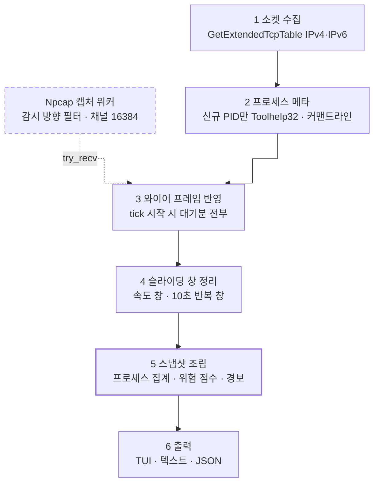
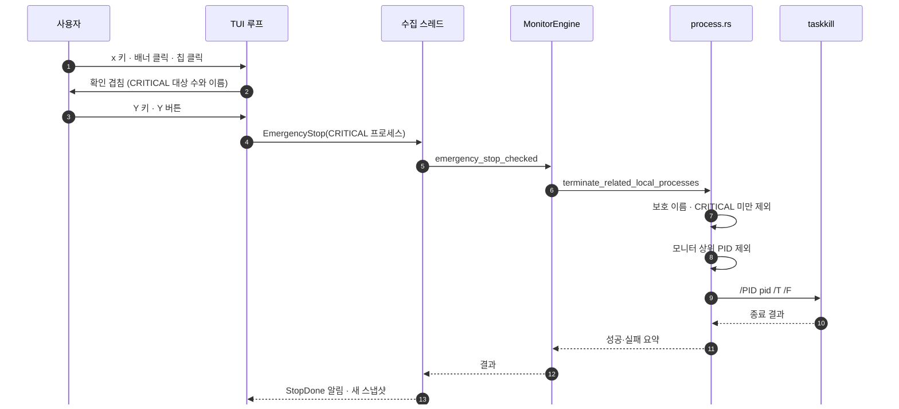

# database-monitor 아키텍처

## 개요

1. **범위**
    - 이 저장소의 모듈 구조, tick 처리 흐름, 위험도 판정, 긴급 중단 경로
2. **문서**
    - 사용법과 설정 형식: [README-ko.md](README-ko.md)
    - 영어 원문: [ARCHITECTURE.md](ARCHITECTURE.md)

---

## 1. 설계 원칙

1. **Zero-DB-Query**
    - 외부 DB에 연결·쿼리를 만들지 않는다. `MonitorSnapshot.zero_db_query_guaranteed`는 항상 `true`다.
    - 관찰 소스는 로컬 OS TCP 테이블, 프로세스 테이블, Npcap 패시브 캡처(`promisc=false`) 세 가지뿐이다.
2. **프로세스 생성 없는 수집**
    - 소켓·프로세스 정보는 Win32 API를 직접 호출한다(`iphlpapi`, `kernel32`, `ntdll`).
    - 외부 프로세스는 종료 명령(`taskkill`) 실행 시에만 띄운다.
3. **로컬 통신 제외**
    - 루프백·같은 소켓의 로컬 IP로 가는 DB 연결은 표시만 하고 모든 위험 집계에서 뺀다.
4. **스레드 모델**
    - TUI 모드에서는 엔진(`MonitorEngine`)이 `collector` 스레드(`tui/poller.rs`)에서 돌고 스냅샷을 채널로 UI 스레드에 보낸다. 렌더 루프는 수집이나 중단 명령을 기다리지 않는다.
    - `--once`와 `--json`은 엔진을 메인 스레드에서 돌린다.
    - 캡처는 인터페이스마다 `database-monitor-wire` 워커 스레드가 디코딩까지 끝내고 bounded 채널(16384)로 넘긴다.
    - `database-monitor-state-writer` 스레드가 UI 상태 파일을 쓰므로 입력 루프는 디스크를 기다리지 않는다(9절).
    - 워커는 감시 대상이 아닌 프레임을 채널에 넣지 않고, SQL 디코딩은 DB로 가는 요청 방향에만 한다. DB 응답(RX)은 길이만 넘긴다.
    - 채널이 가득 차면 워커는 프레임을 버리고 누락 수를 센다(`try_send`). UI는 막히지 않는다.
    - 누락이 생기면 앱 바에 `캡처 누락 N`(영어 `Capture drops N`)을 표시하고, 로그에는 늘었을 때 60초에 한 번 남긴다.
5. **화면 갱신**
    - TUI는 상태가 바뀌었거나(dirty 플래그) 1초 동안 변화가 없을 때 다시 그리며, 쌓인 입력은 모두 처리한 뒤 그린다.
    - 타이머가 루프를 깨운다. 알림 만료(4초), 카드 제목 400ms 길게 누름, 위험 중 경보 점멸이 그렇다.
    - 마우스 이동은 강조 대상(카드, 경계, 열 경계, 스크롤바 트랙)이 바뀔 때만 다시 그리며, 키 뗌 이벤트는 무시한다.
6. **카드 크기 조절**
    - `CardLayout`은 카드 그룹(지표 행·열, 통합관제 행·열, 탭별 목록·상세)마다 경계 위치를 만분율로, 카드 순서를 따로 보관한다. 바꾸지 않은 그룹은 기본 배치를 그대로 쓴다.
    - 그릴 때마다 비율을 현재 터미널 크기로 환산하고 앞 카드부터 최소 크기를 보장한다. 지표 행 높이는 경보 배너와 콘텐츠 8행을 남기도록 제한한다.
    - 분할은 카드 번호 순서의 영역을 돌려주므로 카드 순서를 바꿔도 뷰 호출 지점이 바뀌지 않는다. 칸 크기는 칸에 남는다.
    - 경계 드래그 영역은 행 클릭·머리글 정렬보다 먼저 판정하며, 겹치는 경계 잡기보다 카드 제목이 우선한다.
7. **카드 선택 강조**
    - `views::common::interactive_card`가 카드마다 `CardId`, 영역, 제목 영역을 등록한다. 경보 배너와 겹침은 대상이 아니다.
    - 클릭한 카드는 `(탭, CardId)`로 기억하고 같은 탭에서만 유효하다. 없으면 탭의 주 표가 강조된다. 카드 클릭은 강조만 바꾸고 같은 클릭의 행 선택·머리글 정렬은 그대로 처리한다.
    - 색 우선순위는 위험 적색, 선택(`BORDER_FOCUS`, 굵은 선, 반전 제목), 마우스 아래(`BORDER_HOVER`), 기본 외곽선 순이다. 선택은 색 외에 선 굵기로도 구분한다.
    - 모든 색은 `tui/theme.rs`의 `Color::Indexed` 상수이며 뷰 모듈에는 원시 색이 없다.
8. **화면 언어**
    - 사용자에게 보이는 모든 문구는 영어·한국어 항목을 함께 가진 하나의 카탈로그(`tui/i18n.rs`)에서 나온다. 기본은 영어이며 `L` 키로 재시작 없이 전환한다.
    - 데이터 값(프로세스 이름, 엔드포인트, SQL 원문, 경로, 시스템 오류 문구)은 번역하지 않는다.
    - 엔진과 수집기는 문장 대신 값을 만든다. `app/model.rs`의 `RiskReason`(숫자 포함), `RiskRule`, `RiskSummary`, 중단 결과 타입 `KillError`, `StopSuccess`, `StopFailure`, `StopReport`가 그것이며 카탈로그가 화면 언어로 문구를 만든다.
    - 정렬과 경보 중복 제거는 값 기준이다. 진단 열은 `RiskReason`을 비교하고 경보 키는 `(PID, RiskRule)`이므로 언어를 바꿔도 행 순서와 선택이 바뀌지 않는다.
    - TUI 밖 출력은 영어다. `--once` 텍스트, 로그 줄, stderr 안내가 그렇고 `--json`은 필드 이름을 유지한 채 사유 필드에 카탈로그의 영어 문구를 담는다.
9. **상태 파일**
    - `~/.config/database-monitor/tui.toml`에 버전, 언어, 카드 순서, 경계 비율, 열 폭을 담는다. 9절을 본다.

---

## 2. 디렉터리 구조

1. **트리**

```markdown
database-monitor/
├─ Cargo.toml
├─ build.rs
├─ LICENSE.md
├─ README.md, README-ko.md
├─ ARCHITECTURE.md, ARCHITECTURE-ko.md
├─ assets/icon/
│  ├─ database-monitor.webp, database-monitor-small.webp
│  ├─ database-monitor.ico
│  └─ build_icon.py
├─ docs/
│  └─ config.example.toml
├─ src/
│  ├─ main.rs
│  ├─ lib.rs
│  ├─ app/
│  │  ├─ mod.rs
│  │  ├─ applog.rs
│  │  ├─ cli.rs
│  │  ├─ config.rs
│  │  └─ model.rs
│  ├─ analysis/
│  │  ├─ mod.rs
│  │  ├─ decoder.rs
│  │  └─ risk.rs
│  ├─ platform/
│  │  ├─ mod.rs
│  │  └─ win_ctrl.rs
│  ├─ collector/
│  │  ├─ mod.rs
│  │  ├─ socket.rs
│  │  ├─ process.rs
│  │  └─ wire.rs
│  └─ tui/
│     ├─ mod.rs
│     ├─ state.rs
│     ├─ theme.rs
│     ├─ i18n.rs
│     ├─ layout.rs
│     ├─ layout_store.rs
│     ├─ state_writer.rs
│     ├─ interaction.rs
│     ├─ format.rs
│     ├─ cards.rs
│     ├─ sort.rs
│     ├─ poller.rs
│     └─ views/
│        ├─ mod.rs
│        ├─ common.rs
│        ├─ overview.rs
│        ├─ processes.rs
│        ├─ top_sql.rs
│        └─ alerts.rs
└─ tests/
   ├─ monitor.rs
   ├─ tui.rs
   └─ common/mod.rs
```
```markdown
build.rs: OUT_DIR 에 .rc 스크립트(영어 VERSIONINFO 0x0409, CARGO_MANIFEST_DIR/assets/icon/database-monitor.ico 아이콘)와 asInvoker manifest 를 만들고 windres(WINDRES, 링커 폴더, PATH 순, 아키텍처별 도구 이름, COFF 머신 타입 검사로 aarch64 빌드가 x64 오브젝트를 링크하지 않음)로 컴파일해 링크, windres 가 없으면 경고만 내고 리소스 없이 빌드. gnullvm 타겟이면 libunwind.dll 을 target/<profile> 에 복사
assets/icon: 무손실 WebP 원본(40px 이상용 1024px 타일, 32px 이하용 256px 육각형 크롭), 생성된 ICO, ICO 재생성 스크립트
docs/config.example.toml: 설정 예시 (문서용 가상 IP), 저장소에 포함
src 루트: main.rs 와 lib.rs 만 두고 나머지 모듈은 폴더에 둔다
main.rs: 인자 파싱, 파일 로그 초기화, --once/--json 2회 샘플링, TUI 진입
app/applog.rs: 실행 이력 파일 로그 (~/.config/database-monitor/logs/database-monitor-YYYYMMDD.log)
app/cli.rs: clap 인자 정의, 설정 병합, 텍스트 스냅샷 출력
app/config.rs: 기본 감시 포트, 임계치, config.toml 로더, 설정 파일·상태 파일·로그 폴더 기본 경로, 로컬 통신 판별
app/model.rs: 직렬화 모델 (DbEngine, ActorKind, RiskLevel, MonitorSnapshot)과 값 타입 RiskReason, RiskRule, RiskSummary, 중단 결과
analysis/decoder.rs: L2~L4 헤더 파싱, MySQL/PostgreSQL 명령 디코딩, SQL 정규화·핑거프린트·위험 패턴
analysis/risk.rs: 값 사유로 프로세스 위험 점수 산출, 바이트 포맷터
platform/win_ctrl.rs: 창 최상단 고정, 포그라운드 전환, 작업표시줄 점멸, 클래식 콘솔 글꼴 적용·복원
collector/mod.rs: MonitorEngine (tick 오케스트레이션, 슬라이딩 창, 스냅샷, 경보, 일괄 중단 분기)
collector/socket.rs: GetExtendedTcpTable 소켓 수집, PID 메타데이터 캐시
collector/process.rs: Toolhelp32 프로세스 테이블, 커맨드라인 조회, 상위 체인 분류, 종료 보호·taskkill
collector/wire.rs: Npcap 장치 열기, BPF 필터, 캡처 워커 스레드
tui/mod.rs: 터미널 복원 가드와 panic 훅, 이벤트 루프, 실행 요청 전달, 위험 시 자동 팝업
tui/state.rs: 화면 상태, 실행 요청 enum 을 돌려주는 키 전이, 알림과 신선도
tui/theme.rs: Indexed 색 팔레트와 공용 스타일
tui/i18n.rs: 영어·한국어 문구 카탈로그 (위험 사유, 진단 요약, 중단 결과 문구 포함)
tui/layout.rs: 그룹별 경계 비율과 카드 순서, 최소 크기 안 분할, 경계 드래그 영역
tui/layout_store.rs: tui.toml 읽기, 원자적 저장, 심볼릭 링크 사슬 풀기, 오래된 임시 파일 정리
tui/state_writer.rs: 상태 저장 스레드 (합치는 큐, 종료 때 제한 시간 합류, 실패는 UiMessage 로 반환)
tui/interaction.rs: 시계를 주입하는 포인터 제스처(호버, 클릭, 드래그, 길게 누름, 휠, Shift+방향키)
tui/format.rs: 표시 폭 기준 문자열 맞춤
tui/cards.rs: 카드 식별자·종류, 클릭 영역, 스크롤바 썸 계산
tui/sort.rs: 타입 정렬 키와 3단계 정렬 순환
tui/poller.rs: 엔진을 소유하는 수집 스레드
tui/views/: 클릭 영역만 기록하는 순수 그리기 함수(mod.rs 크롬·겹침, common.rs 카드·표, 탭마다 파일 하나)
tests/monitor.rs: 엔진·위험도·구분선 폭 통합 테스트
tests/tui.rs: 모든 탭을 테스트 버퍼에 그려 검사하는 화면 테스트
tests/common/mod.rs: 공용 픽스처
```

---

## 3. 데이터 흐름

1. **수집 소스에서 화면까지 한 tick의 흐름**



2. **관찰 대상**
    - 실제 OS 소켓 테이블과 캡처 프레임만 본다. 가상 트래픽을 만드는 데모 모드는 없다.
    - `MonitorEngine::tick`은 수집만 하고 `tick_with`에 소켓·메타데이터·프레임을 넘긴다. 통합 테스트는 `tick_with`에 고정 입력을 넣는다.

---

## 4. tick 처리 단계

1. **속도 창**
    - 창 길이는 `max(1초, 직전 tick 이후 경과)`다.
    - 바이트·쿼리 표본은 캡처 시각(`WireFrame.captured_at`)으로 기록하고, 창 합계를 창 길이로 나눠 초당 값으로 만든다.
    - 폴링 주기를 늘려도 `RX/s`와 `QPS`가 부풀지 않는다.
    - 표본은 10초 동안 보관한다. 화면의 순간값은 위 창, 위험 판정은 10초 합계를 10으로 나눈 평균(`평균RX/s`, `평균QPS`)을 쓴다.
2. **소켓 수집 (`SocketScanner::scan`)**
    - TCP 테이블에서 원격 포트가 감시 포트이거나 원격 IP가 `config.toml` 호스트인 행만 남긴다(80/443 제외).
    - IPv4-mapped IPv6 주소는 IPv4로 정규화한다.
    - OS는 `TIME_WAIT` 행의 PID를 0으로 보고한다. 직전 스캔에서 같은 4-튜플을 가졌던 PID로 복원한다.
    - 소유 PID가 프로세스 테이블에 없거나 다른 이름으로 재사용됐으면 복원하지 않는다(종료된 앱에 대기 소켓이 계속 붙는 오탐 방지).
    - 복원하지 못한 PID 0 행은 연결 목록·전체 집계에만 남기고 프로세스 위험·종료 집계에서 뺀다.
    - 소켓에서 사라진 PID는 메타데이터 캐시에서 지운다(PID 재사용 오인 방지).
3. **프로세스 메타데이터**
    - 캐시에 없는 PID가 있을 때만 프로세스 테이블 스냅샷을 한 번 뜬다.
    - 이름은 Toolhelp32, 커맨드라인은 `NtQueryInformationProcess(ProcessCommandLineInformation)`에서 읽는다.
    - 접근 거부로 커맨드라인을 못 읽으면 프로세스 이름으로 대신한다.
4. **와이어 프레임 반영 (`ingest_wire_frame`)**
    - 목적지가 감시 대상이면 송신(TX), 출발지가 감시 대상이면 수신(RX)으로 본다.
    - SQL 프레임은 핑거프린트별 실행 시각을 쌓고 이벤트(최근 150건)를 만든다.
    - 핑거프린트마다 최근 실행 원문(값 포함, 첫 패킷 범위)과 대상 DB를 보관해 하단 상세 패널에 보여 준다.
    - 수신 바이트는 같은 연결의 직전 SQL 이벤트에 귀속해 단일 응답 크기를 잰다. 이벤트 ID가 증가 순서라 이분 탐색으로 찾는다.
    - 프로세스 이름·엔드포인트 문자열은 집계 대상 SQL 프레임에서만 만든다. 응답 프레임 경로는 바이트 합산만 한다.
    - TLS·바이너리 프레임과 로컬 통신은 쿼리 수·핑거프린트에 넣지 않는다.
    - Redis(6379) 페이로드는 SQL 단어 검색 없이 `REDIS::<명령>`으로 표시하고 트래픽만 집계한다.
    - 드라이버·커넥션 풀 관리 명령(`COM_PING`, `SET ...`, `USE`, `BEGIN`/`COMMIT`/`ROLLBACK`, `SELECT 1`, `SELECT @@...`)은 쿼리 수·반복에 넣지 않는다.
    - `COM_STMT_EXECUTE`는 문장을 구분할 수 없어 반복 판정에서 뺀다.
5. **정리**
    - 30초 동안 보이지 않은 연결 상태를 지운다.
    - 10초 창 밖 실행 기록을 지우고, 30분 동안 실행이 없던 핑거프린트를 지운다.
6. **스냅샷 조립 (`build_snapshot`)**
    - 소켓은 연결 행, 비로컬 소켓은 프로세스별 집계, 핑거프린트는 상위 50개 SQL이 된다.
    - 프로세스마다 `evaluate_process_risk`를 돌리고 `WARNING` 이상이면 경보를 만든다.
    - 같은 PID·규칙 경보는 등급이 오르면 즉시, 같거나 낮은 등급이면 60초에 한 번만 기록한다.
    - 경보 로그 줄 끝에 그 PID의 최근 10초 핑거프린트 상위 3개와 횟수를 남기고, 경보 항목에는 같은 SQL의 원문을 담는다.
    - 로그 수준은 `CRITICAL` 경보만 `WARN`, `WARNING` 경보는 `INFO`다.
    - 60초 RX·QPS 이력을 갱신하고 전체 위험도는 프로세스 최댓값으로 정한다.

---

## 5. 위험도 판정

1. **등급 의미**
    - `SAFE` 정상, `CAUTION` 관찰(위험 아님, 표 색만), `WARNING` 주의(경보 이력만), `CRITICAL` 위험
    - 경보 카드·배경 점멸·창 최상단 팝업·일괄 중단 대상은 `CRITICAL`뿐이다.
    - 위험은 DB에 실제 피해가 갈 수 있는 조건(대량 조회 지속, 반복 대량 조회 루프, 쿼리 폭주, 파괴적 SQL)에만 붙는다.
2. **프로세스 판정 규칙 (`analysis/risk.rs`, 기본 임계치)**

| 지표 (10초 기준) | CAUTION | WARNING | CRITICAL |
| --- | --- | --- | --- |
| 평균 수신 `RX/s` | 256 KB | 1 MB | 4 MB |
| 평균 `QPS` | 30 | 100 | 300 |
| 동일 SQL 반복 | 30회 | 100회 | - |
| 평균 RX 1 MB 이상 + (평균 QPS 100 또는 반복 100회) | - | - | 반복 대량 조회 루프 |
| `ESTABLISHED` 수 | 35개 (활동 있을 때만) | 70개 | - |
| `TIME_WAIT`+`SYN` (Redis 제외) | 30개 | 120개 | - |
| Redis `TIME_WAIT`+`SYN` | 30개 | - | - |
| 최근 10초 SQL 패턴 | 패턴 등급 | 패턴 등급 | 패턴 등급 |

3. **점수와 규칙 코드**
    - 점수는 등급 구간(`CAUTION` 20, `WARNING` 50, `CRITICAL` 80)에 동반 사유 1개당 6점(최대 19)을 더한다.
    - 규칙 코드는 최고 등급 사유의 것을 쓴다: `OVER_QUERY_RX`, `QUERY_LOOP`, `QUERY_STORM`, `CONN_HOG`, `CONN_CHURN`, `DANGEROUS_SQL`
    - 행위자 종류(`[AGENT]` 등)는 등급·점수에 영향을 주지 않는다.
    - 쿼리·트래픽이 없는 커넥션 풀(예: HikariCP 20개)은 `SAFE`로 남는다.
    - 임계치는 `config.toml`의 `[thresholds]`로 바꾼다. `caution_*`·`warn_*`·`crit_*`가 각각 관찰·주의·위험 경계다.
4. **SQL 패턴 (`decoder::evaluate_sql_pattern`)**
    - `CRITICAL`: `DROP`/`TRUNCATE`, `WHERE` 없는 `UPDATE`/`DELETE`, `SLEEP(`/`BENCHMARK(`
    - `WARNING`: `ALTER`
    - `CAUTION`: 조건·`LIMIT` 없는 전체 조회
    - 조건 있는 `INSERT`/`UPDATE`/`DELETE`와 `WHERE` 있는 `SELECT *`는 앱 정상 동작으로 보고 `SAFE`다.
5. **SQL 핑거프린트 등급 (과조회SQL 탭)**
    - 문장 패턴 등급과 실측 부하 등급 중 높은 쪽을 쓴다.
    - 실측 부하: 반복 100회 + 평균 응답 1 MB/s 또는 평균 응답 4 MB/s는 `CRITICAL`, 반복 100회 또는 평균 응답 1 MB/s는 `WARNING`
    - 반복 30회 또는 단건 응답 4 MB 이상은 `CAUTION`이다.

---

## 6. 행위자 분류

1. **자체 판별 (`ActorKind::classify`)**
    - 커맨드라인·이름 키워드로 `AGENT` → `SPRING` → `CLIENT` → `SCRIPT` → `PROC` 순서로 첫 일치를 고른다.
2. **상위 체인 판별 (`process::classify_with_ancestry`)**
    - 자체 판별이 `AGENT`가 아니면 부모 PID를 최대 8단계 거슬러 올라간다.
    - 상위 프로세스 이름에 `claude`, `codex`, `antigravity`가 있으면 `AGENT`로 올린다.
    - 에이전트가 셸을 거쳐 띄운 `mysql.exe`, 스크립트, `bootRun`도 에이전트 행위로 잡힌다.

---

## 7. 긴급 중단 (서킷브레이커)

1. **`x` 키 일괄 중단 경로 (확인 포함)**



2. **확인**
    - `x`, `F9`, `F12`, 경보 배너, `[x]` 칩은 어느 것도 바로 중단하지 않고 `K`(선택 프로세스 종료)와 같은 위험 톤 겹침을 연다. 겹침은 `CRITICAL` 대상 수와 이름을 보여 주고 채움 `Y` 와 톤 `N / Esc` 를 둔다.
    - `Y` 키(또는 `Y` 버튼 클릭)만 그 대상으로 `EmergencyStop` 을 보내며, 그 외 키, `Esc`, `N` 은 취소한다.
    - `CRITICAL` 프로세스가 없으면 겹침을 열지 않고 안내만 보여 준다.
    - 최소 크기(60x16) 미만에서는 `K`, `x`, `F9`, `F12`, `Y` 가 아무 일도 하지 않고, 그 아래로 줄어들면 열려 있던 겹침을 취소한다(그리기 경로와 크기 변경 이벤트가 모두 크기를 상태에 반영한다).
3. **보호 대상**
    - PID 0~4, 모니터 자신, `explorer.exe`, `svchost.exe`, `csrss.exe`, `WindowsTerminal.exe`, `conhost.exe` 등 시스템·터미널 프로세스
    - 모니터의 상위 프로세스 체인(셸, 터미널, 모니터를 띄운 에이전트 호스트). `/T` 트리 종료가 모니터를 함께 죽이는 일을 막는다.
    - 종료 직전 프로세스 테이블을 다시 읽어 이미 종료됐거나 이름이 바뀐 PID(재사용 의심)는 종료하지 않는다.
    - `OpenProcess(PROCESS_TERMINATE)`가 접근 거부면 `taskkill`을 띄우지 않고 권한 부족 메시지를 돌려준다.
    - 일괄 중단은 직전 처리 완료 후 2초 안의 중복 요청(키 반복, 연속 클릭)을 무시하고 직전 결과를 다시 보여 준다.
4. **실행 로그**
    - 위치는 `--config`가 다른 곳을 가리켜도 항상 `~/.config/database-monitor/logs/database-monitor-YYYYMMDD.log`이다(`~`는 `USERPROFILE`, 없으면 `HOME`). 홈 폴더가 없으면 로그를 끄고 stderr 한 줄로 알리며 현재 폴더로 대신 쓰지 않는다.
    - 자정을 넘겨 실행하면 다음 기록부터 새 날짜 파일에 쓴다.
    - 시작·종료, 경보, 전체 위험도 변화, 1초 이상 수집 지연, 일괄 중단 요청·제외 대상·`taskkill` 결과, 패닉을 남긴다.
    - 경보 줄에는 `config.toml` 호스트 별칭과 실제 IP가 들어가므로 로그 파일은 공유하지 않는다.

---

## 8. 설정 로드

1. **순서**
    - `MonitorConfig::default()` → `config.toml` 병합 → 명령행 옵션 덮어쓰기
2. **파일 탐색**
    - `--config` 경로 → `~/.config/database-monitor/config.toml`(`~`는 `USERPROFILE`, 없으면 `HOME`). 다른 폴더는 찾지 않는다.
    - `resolve_config_path`는 홈 폴더를 인자로 받으므로 테스트는 실제 홈 대신 임시 홈을 주입한다.
    - 시작 로그 줄에 로드한 설정 경로(없으면 `none`)를 남기며 로그 줄은 영어다.
3. **검증**
    - 알 수 없는 키, IP가 아닌 `hosts` 키·`--host` 값, TOML 형식 오류는 실행 전에 실패한다.
    - 호스트 키는 `IpAddr`로 정규화해 보관한다(IPv4-mapped IPv6는 IPv4). 소켓 행·프레임 판별마다 문자열 변환을 하지 않는다.
    - `poll_interval_ms`는 250~10000ms로 고정한다.
4. **캡처 필터**
    - BPF는 `tcp and (port <감시 포트> or host <등록 호스트>)`로 만든다.
5. **콘솔 글꼴**
    - `console_font`(기본 `D2Coding ligature`)를 클래식 콘솔(conhost) 창에만 적용하고 TUI 종료 시 원래 글꼴로 되돌린다.
    - 콘솔 창 클래스가 `ConsoleWindowClass`가 아니면(Windows Terminal·VS Code 등 ConPTY 의사 창) 프로필 글꼴을 그대로 쓴다. `WT_SESSION`은 WT에서 띄운 conhost 창에도 상속되어 판별에 쓰지 않는다.
    - 글꼴이 설치되지 않아 콘솔이 다른 글꼴로 대체하면 즉시 원복하고 로그에 이유를 남긴다. 빈 문자열이면 바꾸지 않는다.

---

## 9. TUI

1. **모듈 구성**
    - `tui/`는 책임별로 나뉜다. 상태, 테마, 문구 카탈로그, 배치, 상태 저장, 상호작용, 문자열 맞춤, 카드, 탭마다 파일 하나인 `views/`와 `common.rs`가 있다.
    - 상태 변경은 실행 요청 enum 을 돌려주고 `tui/mod.rs`가 I/O 요청을 수집 스레드로 보내므로, 뷰는 클릭 영역만 기록하는 `AppState` 위의 순수 함수로 남는다.
2. **수명 주기**
    - raw 모드, 대체 화면, 마우스 캡처, 숨김 커서를 함께 켜고, `Drop` 가드와 panic 훅이 하나의 멱등 복원 함수를 공유해 되돌린다. 콘솔 글꼴 가드는 그대로 유지한다.
    - 키 뗌 이벤트는 무시하며, 루프는 상태가 바뀌었거나 1초 동안 변화가 없을 때 다시 그린다.
3. **상태 파일**
    - 경로: `~/.config/database-monitor/tui.toml`(`USERPROFILE`, 없으면 `HOME`. `config.toml`과 같은 홈 결정). 테스트는 경로를 주입한다.
    - 저장: 확정 이벤트가 UI 스레드에서 파일 내용을 만들어 `database-monitor-state-writer` 스레드(`tui/state_writer.rs`)로 보낸다. 같은 경로의 요청은 최신 하나로 합쳐지고, 쓰기 실패는 `UiMessage::StateSaveFailed`로 돌아와 오류 알림이 되며, 종료 때 가드가 남은 요청을 쓰고 5초 제한으로 합류한다(디스크가 더 오래 멈추면 stderr 경고).
    - 쓰기: 링크를 푼 실제 파일의 폴더에 임시 파일을 쓰고 `sync_all` 한 뒤 실제 파일 위로 이름을 바꾼다. 심볼릭 링크 사슬은 최대 16단계까지 따라가며(더 긴 사슬이나 순환은 오류), 동기화 폴더로 이어진 링크는 같은 대상을 계속 가리킨다.
    - 읽기: 60초보다 오래된(이 프로세스 것이 아닌) 임시 파일을 지우므로 다른 실행 중인 인스턴스의 파일은 남는다. 읽을 수 없거나 버전이 다른 파일은 첫 덮어쓰기 전에 `tui.toml.bak`으로 복사하며, 잘못된 항목은 건너뛴다. 열 폭은 512칸으로 제한한다.
    - 저장은 확정 이벤트(카드 이동, 경계 드래그, 열 폭 드래그, 언어 전환, 배치 복원)에서만 하고 그리기·호버·스크롤에서는 하지 않는다.
4. **카드와 제스처**
    - 카드 제목을 400ms 길게 누르면 이동 모드에 들어간다. 끌면 새 순서를 실시간으로 미리 보여 주고, 놓으면 확정하며, `Esc`·크기 변경·탭 전환은 순서를 되돌린다.
    - 놓기를 놓친 경우는 화면에 보이는 대로 처리한다. 버튼 없는 첫 움직임이나 새 누름이 미리보기를 확정하고, 그 누름은 클릭으로 실행하지 않는다.
    - 같은 규칙이 카드 경계, 열 폭, 스크롤바 드래그에도 적용된다. 버튼 없는 움직임이 드래그를 놓은 것으로 끝내고 움직인 것이 있었으면 저장 요청을 돌려준다. 새 누름은 모든 드래그 상태를 맨 먼저 초기화하고(움직인 드래그는 저장하고 그 누름은 클릭으로 실행하지 않는다), 탭 전환은 움직인 드래그를 확정한다.
    - 이동 모드의 카드는 점선 테두리(`BorderType::LightDoubleDashed`)를 쓰고, 이중선은 겹침 창 전용으로 남긴다.
    - `Shift+방향키`는 이번 프레임에 그려진 그룹의 포커스 카드를 옮기고, `l`은 탭의 순서·크기·열 폭을 복원하며 언어는 유지한다.
5. **표**
    - 열 폭은 결정 함수가 정한다. 자연 폭이 먼저이고, 글자 열은 가장 넓은 열부터 3칸 바닥까지 줄며, Grow 열 하나가 남는 폭을 가지고, 끌어 정한 폭은 마지막에 줄고, 맨 오른쪽 열은 끝에서만 숨는다.
    - 고정 열(`ColumnFit::Pinned`, 모든 위험 등급 열에 사용)은 폭이 고정되고 다른 열이 모두 숨은 뒤에야 숨으므로 프로세스 표는 100x30과 60x16에서도 `위험도` 열을 유지한다.
    - 머리글 클릭 순환은 숫자·시간 열이 내림차순, 문자 열이 오름차순부터 시작하고 세 번째 클릭이 기본 순위로 되돌린다. `s`와 `S`도 같은 순환이다.

---

## 10. 테스트 구성

1. **단위 테스트**
    - `app/config.rs`: 예시 설정 파싱·병합, 잘못된 호스트 키 거부, IPv4-mapped 호스트 키 정규화, 글꼴 끄기, 주입한 홈 아래 상태 파일·로그 폴더 경로
    - `app/applog.rs`: `database-monitor-` 일자 파일 생성·추가 기록, 자정 롤오버
    - `collector/socket.rs`: 자체 IPv4·IPv6 루프백 연결이 TCP 테이블에 PID와 함께 나오는지
    - `collector/process.rs`: 자체 프로세스 테이블·커맨드라인, 상위 에이전트 분류, 보호 프로세스 종료 거부
    - `collector/wire.rs`, `collector/mod.rs`, `analysis/decoder.rs`, `analysis/risk.rs`: BPF 문자열, TLS 미집계, SQL 분석, 점수
    - `analysis/decoder.rs`: 요청 방향만 SQL 디코딩, 응답 안 SQL 단어 무시, 비감시 포트 프레임 제외
    - `collector/mod.rs`: 이벤트 150건 회전 후에도 응답 바이트가 최신 SQL 이벤트·핑거프린트에 귀속
    - `tui/layout.rs`, `tui/cards.rs`, `tui/sort.rs`, `tui/format.rs`: 기본 배치, 이웃 카드 최소 크기, 크기 변경 시 비율 유지, 카드 순서 삽입·복원 검증, 스크롤바 썸 계산, 정렬 순환, 폭 맞춤
    - `tui/layout_store.rs`: 원자적 저장, 심볼릭 링크 경유 저장, 다단계 링크 사슬, 단계 상한에서 멈추는 링크 순환, `.bak` 복사, 오래된 임시 파일만 정리, 범위 검사, 잘못된 항목 건너뛰기. 모든 테스트가 자기 임시 경로를 주입한다.
    - `tui/state_writer.rs`: 요청 묶음 합치기, 실패 보고와 회복, Drop 시 남은 요청 쓰기, 멈춘 쓰기가 제한 시간에 `TimedOut`으로 합류를 끝내는지
    - `tui/i18n.rs`: 모든 키에 영어·한국어 항목이 있는지, 모든 `RiskReason` 변형이 두 언어로 읽히고 영어에 한글이 없는지, 중단·종료 결과가 시스템 문구는 그대로 두고 언어별로 만들어지는지
2. **통합 테스트 (`tests/monitor.rs`, `tests/tui.rs`)**
    - `tick_with` 고정 입력(실측 로그 사례를 가상 주소로 옮긴 것) 위험 판정, 라이브 엔진 1회 수집
    - `--json` 필드 이름이 유지되고 사유 필드가 한글 없는 영어 문구를 담는지
    - 로컬 DB·Redis 위험 제외, 유휴 커넥션 풀 `SAFE`, Spring 폴링·조건 있는 쓰기 오탐 방지
    - `src/`, `tests/` 번호 구분선 80열 정렬
    - `tests/tui.rs`는 모든 탭을 영어·한국어로 60x16, 100x30, 130x40과 최소 미만 크기에서 그린다.
    - 정확한 셀: 포커스 모서리와 색, 스크롤바 썸·트랙·거터 색, 선택 행 띠, 알림 채움, 최소 크기의 언어·도움말·종료 칩
    - 탭, 칩, 행, 머리글, 열 경계, 스크롤바 트랙, 카드 제목, 겹침 버튼의 클릭 영역
    - 시계를 주입한 제스처: 길게 누름, 끌기 미리보기, 확정, 취소, 놓기 누락(카드 이동, 카드 경계, 열 폭, 스크롤바 드래그), 새 누름이 드래그 상태를 초기화, 탭 전환이 움직인 드래그를 확정, 더블클릭
    - 파괴적 키 안전: 59x15, 59x16, 60x15 에서 `K`, `x`, `F9`, `F12`, `y` 무시, 줄어들 때 열린 확인 취소, 긴급 중단 확인(대상, 위험 톤, 채움 `Y`, `y` 필수), `k`·`j` 선택 이동
    - 이동 모드 카드 테두리 셀(`LightDoubleDashed`, 이중선 없음)
    - 정렬 순환, 열 폭 결정(고정 위험 열 포함), 경계 비율, 색은 `theme.rs`에만 두고 뷰에 한글 리터럴이 없다는 규칙
    - 프로세스·소켓·랭킹·경보 표의 위험 머리글 셀을 100x30과 60x16에서 두 언어로 확인
    - 인스펙터와 경보 화면이 값 사유를 60x16과 130x40에서 영어·한국어로 보여 주고 진단 열이 값 기준으로 정렬되는지
    - 소스 검사: `risk.rs`, `collector/`와 나머지 `src/` 파일의 본문에 `tui/i18n.rs` 밖 한글 리터럴이 없다

---

## 11. 알려진 제약

1. **관찰 범위**
    - TLS로 암호화된 DB 연결은 SQL 원문을 볼 수 없고 트래픽만 집계된다.
    - 디코더는 패킷 단위(최대 2048바이트 캡처)로 본다. 여러 세그먼트로 나뉜 긴 SQL은 첫 패킷만 SQL로 잡힌다.
    - 로컬 판별은 같은 소켓의 로컬 IP와만 비교한다. 다른 NIC 주소로 자기 PC DB에 붙으면 외부로 보인다.
2. **수치**
    - 순간 `QPS`는 정수 내림이다. 창보다 드문 쿼리는 0으로 보일 수 있다. `평균QPS`는 올림이다.
    - 10초 평균은 항상 10으로 나눈다. 모니터 시작 직후 10초는 평균이 낮게 나와 위험 판정이 늦을 수 있다.
    - 표본 시각은 패킷 타임스탬프가 아니라 워커 스레드의 디코딩 시각이다.
3. **플랫폼**
    - Windows 전용이다. 소켓·프로세스 수집은 비Windows에서 빈 결과를 내도록 되어 있으나 비Windows 빌드는 검증하지 않았다.
