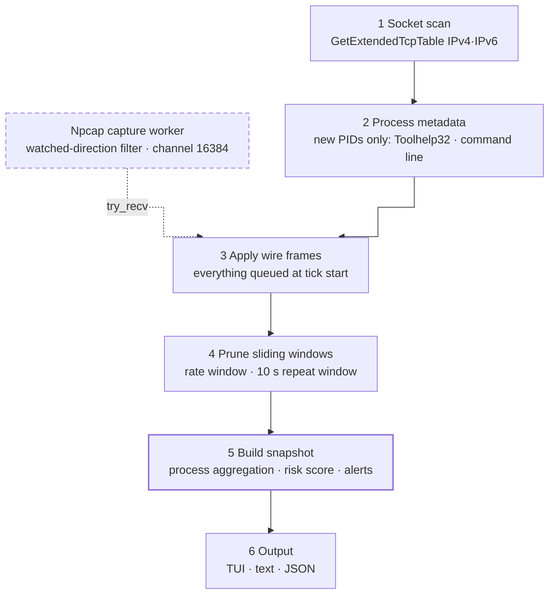
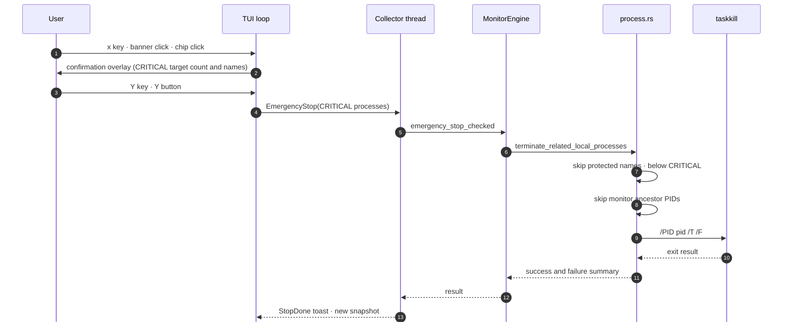

# database-monitor Architecture

## Overview

1. **Scope**
    - The module structure, the tick flow, the risk rules, and the emergency stop path of this repository.
2. **Documents**
    - Usage and the config format: [README.md](README.md)
    - Korean version: [ARCHITECTURE-ko.md](ARCHITECTURE-ko.md)

---

## 1. Design Principles

1. **Zero-DB-Query**
    - The monitor never opens a connection or runs a query against an external DB; `MonitorSnapshot.zero_db_query_guaranteed` is always `true`.
    - It has exactly three observation sources: the local OS TCP table, the process table, and an Npcap passive capture (`promisc=false`).
2. **Collection without spawning processes**
    - Socket and process data come from direct Win32 calls (`iphlpapi`, `kernel32`, `ntdll`).
    - An external process starts only when the stop command (`taskkill`) runs.
3. **Local traffic excluded**
    - A DB connection to loopback or to the same socket's local IP is displayed but left out of every risk aggregate.
4. **Thread model**
    - In TUI mode the engine (`MonitorEngine`) runs on a `collector` thread (`tui/poller.rs`) and sends each `MonitorSnapshot` to the UI thread over a channel; the render loop never waits for collection or for a stop command.
    - `--once` and `--json` run the engine on the main thread.
    - Each capture interface has a `database-monitor-wire` worker thread that finishes decoding and passes the result through a bounded channel (16384).
    - A `database-monitor-state-writer` thread writes the UI state file, so the input loop never waits for the disk (section 9).
    - A worker does not queue frames that are not watched, and decodes SQL only in the request direction toward the DB; DB responses (RX) pass only their length.
    - A request longer than its first segment is held in the worker's own reassembly buffer and decoded once complete (section 5).
    - When the channel is full, the worker drops the frame and counts it (`try_send`), so the UI never blocks.
    - The app bar shows `Capture drops N` (`캡처 누락 N` in Korean) when drops occur, and the log records it once per 60 seconds when the count grows.
5. **Screen refresh**
    - The TUI redraws when the state changed (dirty flag) or after 1 second idle, and drains all queued input before the next draw.
    - Timers wake the loop: toast expiry (4 seconds), the 400 ms card long press, and the alarm blink while critical.
    - Mouse movement redraws only when the hover target (card, border, column edge, scrollbar track) changes; key release events are ignored.
6. **Card resizing**
    - `CardLayout` keeps one card grid per tab (`TabGrid` in `tui/layout/grid.rs`: at most 6 rows of at most 6 cards, `GRID_SLOTS`) and that tab's border ratios in ten-thousandths; a tab that was not changed keeps its default grid.
    - Row 0 of every tab holds the four metric cards; the other default rows are Processes + Sockets, SQL Mix + Top Tables by RX, SQL stream, and Inspector on Overview, and the tab's table and detail card on the other tabs.
    - On every draw, `plan_lines` turns the grid and each card's size condition (`CardSlot`: minimum size, fixed or fill height, rank, reserve) into visible lines: a row wider than the terminal wraps onto the next line, and when the height falls short the lines with the highest rank hide first (the chart row, then the SQL stream), then lines hide from the bottom.
    - The alert banner (siren band) is drawn at the top of the body, above the grid.
    - Ratios are kept per tab: width cuts per grid row (`<tab>_cols_<row>`) and line height cuts per visible line count (`<tab>_rows_<count>`).
    - Border drag areas are tested before row clicks and header sorting; a card title outranks a border grab that overlaps it.
7. **Card selection highlight**
    - `views::common::interactive_card` registers each card's `CardId`, area, and title area; the alert banner and the overlays are not targets.
    - A clicked card is remembered as `(tab, CardId)` and is valid on that tab only; without one, the tab's main table is highlighted. A card click only changes the highlight, and the row selection and header sort of the same click still run.
    - Color priority is danger red, selection (`BORDER_FOCUS`, thick line, inverted title), mouse hover (`BORDER_HOVER`), then the default outline; selection is also distinguished by line weight, not color alone.
    - Every color is a `Color::Indexed` constant in `tui/theme.rs`; view modules hold no raw color.
8. **Display language**
    - Every user-visible string comes from one catalog (`tui/i18n.rs`) with an English and a Korean entry; the default is English and `L` switches it without a restart.
    - Data values (process names, endpoints, SQL text, paths, system error text) are not translated.
    - The engine and the collector emit typed values instead of sentences: `RiskReason` (with its numbers), `RiskRule`, `RiskSummary`, and the stop outcome types `KillError`, `StopSuccess`, `StopFailure`, and `StopReport` in `app/model.rs`; the catalog renders them in the active language.
    - Sorting and alert de-duplication use the typed values (the diagnosis columns compare `RiskReason`, the alert key is `(PID, RiskRule)`), so a language switch never reorders rows or moves the selection.
    - Non-TUI output is English: the `--once` text, log lines, and stderr notices; `--json` keeps its field names and carries the English catalog text in the reason fields.
9. **State file**
    - `~/.config/database-monitor/tui.toml` holds the version, language, card grids (`[grids]`), grid ratios (`[grid_ratios]`), column widths, and the tab order (`tab_order`, written only when not the default and skipped unless it is a permutation of the four tabs; `l` keeps it); see section 9.

---

## 2. Directory Layout

1. **Tree**

```markdown
database-monitor/
├─ Cargo.toml
├─ build.rs
├─ LICENSE.md
├─ README.md, README-ko.md
├─ ARCHITECTURE.md, ARCHITECTURE-ko.md
├─ assets/icon/
│  ├─ database-monitor.webp, database-monitor-small.webp
│  ├─ database-monitor.ico
│  └─ build_icon.py
├─ docs/
│  └─ config.example.toml
├─ src/
│  ├─ main.rs
│  ├─ lib.rs
│  ├─ app/
│  │  ├─ mod.rs
│  │  ├─ applog.rs
│  │  ├─ cli.rs
│  │  ├─ config.rs
│  │  └─ model.rs
│  ├─ analysis/
│  │  ├─ mod.rs
│  │  ├─ decoder.rs
│  │  ├─ reassembly.rs
│  │  └─ risk.rs
│  ├─ platform/
│  │  ├─ mod.rs
│  │  └─ win_ctrl.rs
│  ├─ collector/
│  │  ├─ mod.rs
│  │  ├─ socket.rs
│  │  ├─ process.rs
│  │  └─ wire.rs
│  └─ tui/
│     ├─ mod.rs
│     ├─ state.rs
│     ├─ theme.rs
│     ├─ i18n.rs
│     ├─ layout.rs
│     ├─ layout/
│     │  └─ grid.rs
│     ├─ layout_store.rs
│     ├─ state_writer.rs
│     ├─ format.rs
│     ├─ cards.rs
│     ├─ card_move.rs
│     ├─ mouse.rs
│     ├─ sort.rs
│     ├─ poller.rs
│     ├─ tab_move.rs
│     └─ views/
│        ├─ mod.rs
│        ├─ common.rs
│        ├─ charts.rs
│        ├─ overview.rs
│        ├─ processes.rs
│        ├─ top_sql.rs
│        └─ alerts.rs
└─ tests/
   ├─ monitor.rs
   ├─ tui.rs
   ├─ tui_charts.rs
   ├─ tui_grid.rs
   └─ common/mod.rs
```
```markdown
build.rs: generates the .rc script (English VERSIONINFO 0x0409, the icon from CARGO_MANIFEST_DIR/assets/icon/database-monitor.ico) and an asInvoker manifest in OUT_DIR, compiles them with windres (WINDRES, the linker folder, then PATH; a per-architecture tool name, and a COFF machine-type check so an aarch64 build never links an x64 object) and links the object; when windres is missing it only warns and builds without resources; for a gnullvm target it copies libunwind.dll to target/<profile>
assets/icon: lossless WebP masters (a 1024 px tile for 40 px and larger, a 256 px hexagon crop for 32 px and smaller), the generated ICO, and the ICO regeneration script
docs/config.example.toml: example config with documentation-only IPs, committed to the repository
src root: only main.rs and lib.rs; every other module lives in a folder
main.rs: argument parsing, file log setup, two-sample --once/--json, TUI entry
app/applog.rs: run-history file log (~/.config/database-monitor/logs/database-monitor-YYYYMMDD.log)
app/cli.rs: clap argument definitions, config merge, text snapshot output
app/config.rs: default watched ports, thresholds, the config.toml loader, the default config, state file, and log folder paths, local traffic test
app/model.rs: serializable models (DbEngine, ActorKind, RiskLevel, MonitorSnapshot) and the typed RiskReason, RiskRule, RiskSummary, and stop outcome values
analysis/decoder.rs: L2 to L4 header parsing, MySQL/PostgreSQL command decoding, SQL normalization, fingerprints, risk patterns
analysis/reassembly.rs: per-flow reassembly of request segments split across packets, with size, flow count, and time limits
analysis/risk.rs: per-process risk score with typed reasons, byte formatter
platform/win_ctrl.rs: window top-most pinning, foreground switch, taskbar blink, classic-console font apply and restore
collector/mod.rs: MonitorEngine (tick orchestration, sliding windows, snapshot, alerts, bulk stop branch)
collector/socket.rs: GetExtendedTcpTable socket collection, PID metadata cache
collector/process.rs: Toolhelp32 process table, command line lookup, ancestor chain classification, stop protection and taskkill
collector/wire.rs: Npcap device open, BPF filter, capture worker threads
tui/mod.rs: terminal restore guard and panic hook, event loop, command dispatch, automatic popup on danger
tui/state.rs: screen state, key transitions returning a command enum, toast and freshness
tui/theme.rs: Indexed color palette and shared styles
tui/i18n.rs: English and Korean message catalog, including the text of typed reasons, summaries, and stop outcomes
tui/layout.rs: per-tab card grids and their border ratios, border drag areas
tui/layout/grid.rs: tab grid (rows of cards), default grids, card keys for the state file, visible line planning, drop target resolution, Shift+arrow moves
tui/layout_store.rs: tui.toml load (with the legacy `[orders]` / `[ratios]` migration), atomic save, symbolic link chain resolution, stale temporary file cleanup
tui/state_writer.rs: state save thread (coalescing queue, bounded join on exit, failures returned as a UiMessage)
tui/mouse.rs: pointer gestures with an injected clock (hover, click, card border, column edge, scrollbar, and tab drags, wheel)
tui/card_move.rs: card move (long press on the title, preview, commit, cancel, Shift+arrows)
tui/tab_move.rs: tab reordering by tab drag and the `<` `>` keys
tui/format.rs: display-width text fitting
tui/cards.rs: card ids and kinds, hit areas, scrollbar thumb math
tui/sort.rs: typed sort keys and the three-step sort cycle
tui/poller.rs: collector thread that owns the engine
tui/views/: pure render functions that record hit areas (mod.rs chrome and overlays, common.rs cards and tables, charts.rs bar cards and sparkline trend, one file per tab)
tests/monitor.rs: integration tests for the engine, risk, and divider width
tests/tui.rs: screen tests that render every tab into a test buffer
tests/tui_charts.rs: bar card rows and rendering, sparkline legend and colors
tests/tui_grid.rs: grid render and gesture tests
tests/common/mod.rs: shared fixtures
```

---

## 3. Data Flow

1. **One tick, from source to screen**



2. **What is observed**
    - Only the real OS socket table and captured frames; there is no demo mode that fabricates traffic.
    - `MonitorEngine::tick` only collects and hands sockets, metadata, and frames to `tick_with`; the integration tests feed fixed input to `tick_with`.

---

## 4. Tick Stages

1. **Rate window**
    - The window length is `max(1 s, time since the previous tick)`.
    - Byte and query samples are stamped with the capture time (`WireFrame.captured_at`), and the window total divided by the window length gives a per-second value.
    - A longer polling interval does not inflate `RX/s` or `QPS`.
    - Samples are kept for 10 seconds; the screen shows the instant value of the window above, and risk uses the 10-second total divided by 10 (`평균RX/s`, `평균QPS`, the average RX/s and average QPS).
2. **Socket collection (`SocketScanner::scan`)**
    - From the TCP table, only rows whose remote port is a watched port or whose remote IP is a `config.toml` host stay (80 and 443 excluded).
    - IPv4-mapped IPv6 addresses are normalized to IPv4.
    - The OS reports PID 0 for `TIME_WAIT` rows; the PID that owned the same 4-tuple in the previous scan is restored.
    - The PID is not restored when it is missing from the process table or was reused under another name, so a dead app does not keep collecting waiting sockets as false positives.
    - A PID 0 row that could not be restored stays only in the connection list and the overall totals, and is left out of process risk and stop aggregation.
    - A PID that vanished from the sockets is dropped from the metadata cache, which avoids confusion over PID reuse.
3. **Process metadata**
    - A process table snapshot is taken once, and only when a PID is missing from the cache.
    - The name comes from Toolhelp32 and the command line from `NtQueryInformationProcess(ProcessCommandLineInformation)`.
    - When access is denied and the command line cannot be read, the process name stands in for it.
4. **Applying wire frames (`ingest_wire_frame`)**
    - A watched destination means send (TX), and a watched source means receive (RX).
    - SQL frames accumulate execution times per fingerprint and create events (latest 150).
    - Each fingerprint keeps its latest SQL text (values included, up to 16 KB after whitespace folding) and target DB for the bottom detail panel.
    - Received bytes are attributed to the previous SQL event of the same connection to measure a single response size; event IDs increase, so the lookup is a binary search.
    - Process name and endpoint strings are built only from SQL frames that are aggregated; the response frame path only sums bytes.
    - TLS and binary frames and local traffic do not enter query counts or fingerprints.
    - A Redis (6379) payload is shown as `REDIS::<command>` without SQL keyword search, and only traffic is aggregated.
    - Driver and pool housekeeping (`COM_PING`, `SET ...`, `USE`, `BEGIN`/`COMMIT`/`ROLLBACK`, `SELECT 1`, `SELECT @@...`) does not enter query counts or repeats.
    - `COM_STMT_EXECUTE` cannot tell statements apart, so it is left out of repeat detection.
5. **Cleanup**
    - Connection state not seen for 30 seconds is erased.
    - Execution records outside the 10-second window are erased, and a fingerprint with no execution for 30 minutes is erased.
6. **Snapshot assembly (`build_snapshot`)**
    - Sockets become connection rows, non-local sockets become per-process aggregates, and fingerprints become the top 50 SQL.
    - `evaluate_process_risk` runs for every process, and an alert is created at `WARNING` or above.
    - An alert for the same PID and rule is recorded immediately when its level rises, and at most once per 60 seconds when the level is equal or lower.
    - Each alert log line ends with that PID's top 3 fingerprints of the last 10 seconds with their counts, and the alert item carries the SQL text of the same statements.
    - Log level: only a `CRITICAL` alert is `WARN`; a `WARNING` alert is `INFO`.
    - The 60-second RX and QPS history is updated, and the overall risk is the maximum over processes.

---

## 5. Risk Rules

1. **Level meaning**
    - `SAFE` normal, `CAUTION` observe (not a risk, table color only), `WARNING` attention (alert history only), `CRITICAL` danger.
    - The alert card, background blink, top-most popup, and bulk stop target `CRITICAL` only.
    - `CRITICAL` is reserved for conditions that can really hurt the DB: sustained bulk reads, repeated bulk read loops, query storms, and destructive SQL.
2. **Process rules (`analysis/risk.rs`, default thresholds)**

| Metric (10-second basis) | CAUTION | WARNING | CRITICAL |
| --- | --- | --- | --- |
| Average inbound `RX/s` | 256 KB | 1 MB | 4 MB |
| Average `QPS` | 30 | 100 | 300 |
| Same SQL repeats | 30 | 100 | - |
| Average RX of 1 MB or more + (average QPS 100 or 100 repeats) | - | - | repeated bulk read loop |
| `ESTABLISHED` count | 35 (only when active) | 70 | - |
| `TIME_WAIT`+`SYN` (Redis excluded) | 30 | 120 | - |
| Redis `TIME_WAIT`+`SYN` | 30 | - | - |
| SQL pattern of the last 10 seconds | pattern level | pattern level | pattern level |

3. **Score and rule code**
    - The score starts at the level band (`CAUTION` 20, `WARNING` 50, `CRITICAL` 80) and adds 6 per accompanying reason (up to 19).
    - The rule code is the one of the highest-level reason: `OVER_QUERY_RX`, `QUERY_LOOP`, `QUERY_STORM`, `CONN_HOG`, `CONN_CHURN`, `DANGEROUS_SQL`
    - The actor kind (`[AGENT]` and so on) does not affect level or score.
    - A connection pool with no queries or traffic (for example 20 HikariCP connections) stays `SAFE`.
    - Thresholds change through `[thresholds]` in `config.toml`; `caution_*`, `warn_*`, and `crit_*` are the observe, attention, and danger boundaries.
4. **SQL patterns (`decoder::evaluate_sql_pattern`)**
    - `CRITICAL`: `DROP`/`TRUNCATE`, `UPDATE`/`DELETE` without `WHERE`, `SLEEP(`/`BENCHMARK(`
    - `WARNING`: `ALTER`
    - `CAUTION`: a full read with no condition or `LIMIT`
    - `INSERT`/`UPDATE`/`DELETE` with a condition and `SELECT *` with `WHERE` are normal app behavior and `SAFE`.
    - `WHERE`, `FROM`, and `LIMIT` count only as tokens outside string literals, backticks, comments, and parentheses, so a `WHERE` inside a subquery alone does not count.
    - Leading comments are stripped before the command is classified, and `INSERT ... ON DUPLICATE KEY UPDATE` stays an `INSERT`.
    - The missing `WHERE` and missing `LIMIT` rules judge only a complete statement: the captured bytes reach the declared length (MySQL packet length, PostgreSQL message length) and the text is at most 16 KB after whitespace folding. A plain-text fallback scan is always incomplete.
    - An incomplete statement is shown with a trailing ` ...` and never raises those rules; `DROP`/`TRUNCATE`, `ALTER`, and `SLEEP(`/`BENCHMARK(` decide from the leading part and still apply.
    - Segment reassembly (`analysis/reassembly.rs`): a MySQL text command (`COM_QUERY`, `COM_STMT_PREPARE`) or PostgreSQL `Q`/`P` message longer than its first segment is collected per worker by flow and sequence number (at most 256 KiB per flow, 256 flows, 2 seconds) and judged once when the declared length is reached.
    - A sequence gap, a timeout, or a limit gives up: the collected front part is reported once as an incomplete statement.
5. **SQL fingerprint level (over-query SQL tab)**
    - The higher of the statement pattern level and the measured load level is used.
    - Measured load: 100 repeats with an average response of 1 MB/s, or an average response of 4 MB/s, is `CRITICAL`; 100 repeats or an average response of 1 MB/s is `WARNING`.
    - 30 repeats or a single response of 4 MB or more is `CAUTION`.

---

## 6. Actor Classification

1. **Own classification (`ActorKind::classify`)**
    - The first match of command line and name keywords is chosen in the order `AGENT`, `SPRING`, `CLIENT`, `SCRIPT`, `PROC`.
2. **Ancestor classification (`process::classify_with_ancestry`)**
    - When the own classification is not `AGENT`, the parent PID is followed up to 8 levels.
    - A parent process name containing `claude`, `codex`, or `antigravity` raises the actor to `AGENT`.
    - A `mysql.exe`, a script, or a `bootRun` that an agent started through a shell is also caught as agent behavior.

---

## 7. Emergency Stop (Circuit Breaker)

1. **The `x` key bulk stop path (with confirmation)**



2. **Confirmation**
    - `x`, `F9`, `F12`, the alert banner, and the `[x]` chip never stop anything directly: they open the same critical-tone overlay as `K` (kill the selected process), listing the `CRITICAL` target count and names, with a filled `Y` and a tonal `N / Esc`.
    - Only `Y` (or a click on the `Y` button) sends `EmergencyStop` with those targets; any other key, `Esc`, or `N` cancels it.
    - With no `CRITICAL` process no overlay opens and a notice is shown instead.
    - Below the minimum size (60x16) `K`, `x`, `F9`, `F12`, and `Y` do nothing, and a resize below it cancels an open overlay (the render path and the resize event both apply the size to the state).
3. **Protected targets**
    - PIDs 0 to 4, the monitor itself, and system and terminal processes such as `explorer.exe`, `svchost.exe`, `csrss.exe`, `WindowsTerminal.exe`, `conhost.exe`
    - The monitor's ancestor chain (shell, terminal, the agent host that started the monitor); this stops a `/T` tree kill from killing the monitor too.
    - Just before the kill, the process table is read again, and a PID that already exited or changed its name (suspected reuse) is not killed.
    - When `OpenProcess(PROCESS_TERMINATE)` is denied, `taskkill` is not started and a missing-permission message is returned.
    - A bulk stop ignores a duplicate request (key repeat, repeated click) within 2 seconds after the previous one finished, and shows the previous result again.
4. **Run log**
    - It always lives at `~/.config/database-monitor/logs/database-monitor-YYYYMMDD.log` (`~` is `USERPROFILE`, or `HOME`), also when `--config` points elsewhere; with no home folder logging is off and one stderr line says so, with no fallback to the current folder.
    - After midnight, the next record goes to the new date's file.
    - It records start and stop, alerts, overall risk changes, collection delays of 1 second or more, bulk stop requests, excluded targets, `taskkill` results, and panics.
    - Alert lines contain `config.toml` host aliases and real IPs, so do not share log files.

---

## 8. Config Loading

1. **Order**
    - `MonitorConfig::default()`, then the `config.toml` merge, then command-line overrides.
2. **File search**
    - The `--config` path, then `~/.config/database-monitor/config.toml` (`~` is `USERPROFILE`, or `HOME` when that is unset); no other folder is searched.
    - `resolve_config_path` takes the home folder as an argument, so tests inject a temporary home instead of reading the real one.
    - The startup log line records the loaded config path (`none` when absent); log lines are English.
3. **Validation**
    - An unknown key, a `hosts` key or `--host` value that is not an IP, and a TOML format error fail before the run starts.
    - Host keys are stored normalized as `IpAddr` (IPv4-mapped IPv6 becomes IPv4), so socket rows and frames are matched without string conversion.
    - `poll_interval_ms` is clamped to 250 to 10000 ms.
4. **Capture filter**
    - BPF is built as `tcp and (port <watched port> or host <registered host>)`.
5. **Console font**
    - `console_font` (default `D2Coding ligature`) applies to the classic console (conhost) window only, and the original font is restored when the TUI exits.
    - When the console window class is not `ConsoleWindowClass` (a ConPTY pseudo window such as Windows Terminal or VS Code), the profile font stays; `WT_SESSION` is inherited by conhost windows started from WT, so it is not used for detection.
    - When the font is not installed and the console substitutes another one, the original is restored at once and the reason is logged; an empty string changes nothing.

---

## 9. TUI

1. **Module layout**
    - `tui/` splits by responsibility: state, theme, message catalog, layout, state store, pointer gestures (mouse), card move, tab move, text fitting, cards, and `views/` with one file per tab plus `common.rs`.
    - State changes return a command enum; `tui/mod.rs` sends I/O commands to the collector thread, so views stay pure functions over `AppState` that only record hit areas.
2. **Lifecycle**
    - Raw mode, the alternate screen, mouse capture, and a hidden cursor are entered together and restored by a `Drop` guard and a panic hook that share one idempotent restore; the console font guard stays.
    - Key release events are ignored; the loop redraws on dirty state or after 1 second idle.
3. **State file**
    - Path: `~/.config/database-monitor/tui.toml` (`USERPROFILE`, then `HOME`, the same home resolution as `config.toml`); the path is injected in tests.
    - Save: a commit event builds the file text on the UI thread and queues it to the `database-monitor-state-writer` thread (`tui/state_writer.rs`); requests for one path coalesce to the latest, a failed write comes back as `UiMessage::StateSaveFailed` and shows an error toast, and on exit the guard writes the remaining request and joins with a 5-second limit (a stderr warning when the disk stalls longer).
    - Write: temporary file in the resolved file's folder, `sync_all`, then rename over the resolved file; the symbolic link chain is followed up to 16 links (a longer chain or a loop is an error), so a link to a synced folder keeps pointing to the same target.
    - Load: temporary files older than 60 seconds (and not this process's) are removed, so another running instance's file stays; an unreadable or other-version file is copied to `tui.toml.bak` before the first overwrite, and invalid entries are skipped; column widths are capped at 512.
    - Migration: a file with the legacy `[orders]` / `[ratios]` tables is read once and converted into `[grids]` and `[grid_ratios]` (the metric card order and width ratio go to row 0 of every tab, the Overview table width ratio to Overview row 1, and a grid already stored for a tab wins over that tab's `[orders]`); row-height ratios are dropped, the converted tables are never written again, and the file is copied to `tui.toml.bak` at load, before the first save.
    - Save happens only on commit events (card move, split drag, column drag, tab move, language switch, layout reset), never on render, hover, or scroll.
4. **Cards and gestures**
    - A 400 ms long press on a card title enters move mode; dragging previews the new grid live across rows, release commits and saves, `Esc`, a resize, or a tab switch restores the grid from before the press.
    - The drop target comes from the lines drawn when the card was pressed (`resolve_drop`): a row's bottom border or another row's top border makes a new row, the inside of a row joins it before or after a neighbor, and the top border of the moving card's own row counts as inside; a row left empty is removed, and a drop that would pass 6 rows or 6 cards in a row is refused and the preview stays.
    - A move on one tab never changes another tab's grid.
    - A lost button release resolves to what the screen shows: the first buttonless move or a new press commits the preview, and that press is consumed.
    - The same rule ends card border, column width, and scrollbar drags: a buttonless move ends them like a release and returns a save request when something moved; a new press resets every drag state first (a moved drag is saved and that press is consumed), and a tab switch commits a moved drag.
    - Pressing a tab and dragging it previews the new tab order, release commits and saves it, `Esc` restores the order from before the press, and a lost release commits the preview; `<` and `>` move the current tab one slot.
    - A column edge shows a faint `│` in the header row at rest; it is grabbed from the edge cell and one header cell on each side, and on hover or drag a `┃` spans the full table height.
    - The move-mode card uses a dashed border (`BorderType::LightDoubleDashed`); double lines stay reserved for overlays.
    - `Shift+←` / `Shift+→` swap the focused card with its drawn neighbor in the row; `Shift+↑` / `Shift+↓` (`shift_card`) move a card that shares its row into a new row above or below, and a card alone in its row joins the end of the nearest row above or below, so repeated presses alternate; only cards drawn this frame are moved.
    - `l` resets the grid, grid ratios, and column widths of the current tab only; the tab order and the language stay.
5. **Tables**
    - Column widths come from a resolver: natural widths first, text columns shrink widest-first to a 3-cell floor, one grow column takes the slack, dragged widths shrink last, and right-most columns hide only at the end.
    - A pinned column (`ColumnFit::Pinned`, used for every risk level column) has a fixed width and hides only after all other columns, so the process table keeps `Risk` at 100x30 and 60x16.
    - The header click cycle is descending first for numeric and time columns, ascending first for text, and the third click resets to the default order; `s` and `S` follow the same cycle.

---

## 10. Test Layout

1. **Unit tests**
    - `app/config.rs`: example config parsing and merge, invalid host key rejection, IPv4-mapped host key normalization, font off, state file and log folder paths under an injected home
    - `app/applog.rs`: dated `database-monitor-` file creation and append, midnight rollover
    - `collector/socket.rs`: that the process's own IPv4 and IPv6 loopback connections appear in the TCP table with a PID
    - `collector/process.rs`: own process table and command line, ancestor agent classification, refusal to kill protected processes
    - `collector/wire.rs`, `collector/mod.rs`, `analysis/decoder.rs`, `analysis/risk.rs`: BPF string, TLS not counted, SQL analysis, score
    - `analysis/decoder.rs`: SQL decoding in the request direction only, SQL words inside responses ignored, frames on unwatched ports dropped
    - `analysis/decoder.rs`: a long indented `UPDATE` keeps its trailing `WHERE`, incomplete statements raise no missing-condition alert, top-level `WHERE` search (subquery, literal, comment, backtick), leading comment classification, PostgreSQL message length
    - `analysis/reassembly.rs`, `analysis/decoder.rs`: in-order segments assemble, a sequence gap or a timeout gives up as incomplete, size and flow count limits, memory released
    - `collector/mod.rs`: response bytes stay attributed to the latest SQL event and fingerprint after the 150-event rotation
    - `tui/layout/grid.rs`: default grids with the metric cards on row 0 of every tab, card key round trip, line wrapping, rank-based hiding, drop target resolution, drop caps (6 cards per row, 6 rows), `Shift+arrow` swaps and alternating vertical moves
    - `tui/layout.rs`, `tui/cards.rs`, `tui/sort.rs`, `tui/format.rs`: default layout, neighbor minimum size, ratio kept on resize, card order insertion and restore checks, scrollbar thumb math, sort cycle, width fitting
    - `tui/layout_store.rs`: atomic save, save through a symbolic link, a multi-level link chain, a link loop stopping at the depth limit, `.bak` copy, cleanup of stale temporary files only, range checks, invalid entries skipped; every test injects its own temporary path
    - `tui/layout_store.rs`: `[grids]` and `[grid_ratios]` round trip, legacy `[orders]` / `[ratios]` migration with one `.bak` and no rewrite, a stored grid winning over a legacy order, invalid legacy values dropped without a notice
    - `tui/state_writer.rs`: coalescing of a request burst, failure reporting and recovery, flush on drop, and a stuck write ending the join with `TimedOut` at the limit
    - `tui/i18n.rs`: every key has an English and a Korean entry; every `RiskReason` variant reads in both languages and English holds no Hangul; stop and kill outcomes render per language with untranslated system text
2. **Integration tests (`tests/monitor.rs`, `tests/tui.rs`, `tests/tui_charts.rs`, `tests/tui_grid.rs`)**
    - `tests/tui_charts.rs`: SQL Mix rows (per-kind sums) and Top Tables by RX rows (`!n` warning flag), bar rendering at 44 and 24 columns, trend repetition, sparkline series colors with a `━` legend mark and a right-aligned sparkline
    - `tests/tui_grid.rs`: default grids of every tab at 60x16, 100x30, and 130x40 in both languages, chart row visibility, the siren band above the grid, long press and drag moves across rows, border drops, lost release, `Esc`/resize/tab-switch restore, `Shift+arrow` moves, `l` resetting only the current tab, and every drop target rendering without overlap
    - Risk judgment with fixed `tick_with` input (field log cases moved to documentation addresses), and one live engine collection
    - `--json` field names stay and the reason fields carry English text with no Hangul
    - Local DB and Redis risk exclusion, idle connection pool `SAFE`, no false positives for Spring polling and conditional writes
    - 80-column alignment of divider comments in `src/` and `tests/`
    - `tests/tui.rs` renders every tab in English and Korean at 60x16, 100x30, and 130x40 plus below-minimum sizes
    - Exact cells: focus corner and color, scrollbar thumb, track, and gutter color, selected row band, toast fill, language, help, and quit chips at the minimum size
    - Hit areas for tabs, chips, rows, headers, column edges, scrollbar tracks, card titles, and the overlay buttons
    - Gestures through injected clocks: long press, drag preview, commit, cancel, lost release (card move, card border, column width, scrollbar, and tab drags), a new press resetting drag states, a tab switch committing a moved drag, double-click
    - Kill safety: `K`, `x`, `F9`, `F12`, and `y` ignored at 59x15, 59x16, and 60x15, a shrink cancelling an open confirmation, the emergency stop confirmation (targets, critical tone, filled `Y`, `y` required), and `k` and `j` moving the selection
    - The move-mode card border cells (`LightDoubleDashed`, no double line)
    - Sort cycle, column resolver (including the pinned risk column), split ratios, and the rule that colors live only in `theme.rs` and views hold no inline Korean text
    - The `Risk` header cell of the process, socket, ranking, and alert tables at 100x30 and 60x16 in both languages
    - The inspector and alert views show a typed risk reason in English and Korean at 60x16 and 130x40, and the diagnosis columns sort by typed value
    - A source scan: no Korean literal outside `tui/i18n.rs` in the production code of `risk.rs`, `collector/`, and every other `src/` file

---

## 11. Known Limits

1. **Observation scope**
    - SQL text of a TLS-encrypted DB connection cannot be seen; only traffic is aggregated.
    - Capture takes up to 2048 bytes per packet. A segment longer than that (for example large send offload) leaves a sequence gap, so reassembly gives up and the statement stays incomplete: no missing-condition alert, but its front part is still counted as one query.
    - Reassembly takes in-order segments only; a retransmission or reordering inside a statement also gives up.
    - The local test compares only with the same socket's local IP; connecting to your own PC's DB through another NIC address looks external.
2. **Numbers**
    - The instant `QPS` rounds down to an integer, so a query rarer than the window can read 0; `평균QPS` (average QPS) rounds up.
    - The 10-second average always divides by 10, so for the first 10 seconds after the monitor starts the average reads low and risk judgment can be late.
    - The sample time is the worker thread's decode time, not the packet timestamp.
3. **Platform**
    - Windows only; socket and process collection are written to return empty results on non-Windows, but non-Windows builds were not verified.
